# ER Model — GardenPay

Derived from `docs/architecture.md`. Notation: crow's foot (Mermaid ER), keys marked **PK** (primary), **UK** (unique), **FK** (foreign).

## Conventions

- All money amounts are integer minor units (`amount_minor`, `bigint`) — never floats.
- `id` PKs are `uuid` (generated by Postgres) unless noted.
- Relationship line styles: **solid** `--` = identifying (FK mandatory, child needs parent); **dashed** `..` = non-identifying (FK nullable).
- Ledger (`ledger_entries`) and `audit_log` are append-only; corrections via compensating entries.
- Enumerated `status`/`type` fields are constrained by Postgres `CHECK`/lookup tables.

---

## 1. Entities

### 1.1 Core (Membership & Land)

| Entity | PK | UK | FK | Other key fields |
|---|---|---|---|---|
| `household` | `id` | — | — | `name`, `address`, `created_at` |
| `profile` | `id` (= `auth.users.id`) | `email` | `household_id`? | `full_name`, `phone`, `locale`, `avatar_url`, `created_at` |
| `role` | `code` | — | — | `name`, `description` (board, treasurer, admin, auditor, leader) |
| `profile_role` | (`profile_id`, `role_code`) | — | `profile_id`, `role_code` | `granted_at`, `expires_at`? |
| `membership` | `id` | `member_no` | `profile_id` | `type` (full/tenant/associate), `status` (active/suspended/lapsed), `joined_at`, `left_at`? |
| `waiting_list` | `id` | — | `membership_id`? (conversion) | `name`, `email`, `size_request_m2`, `applied_at`, `status` |
| `plot` | `id` | `plot_no` | — | `area_m2`, `zone`, `soil_type`, `status` (free/allocated/reserved) |
| `plot_assignment` | `id` | — | `plot_id`, `membership_id` | `relation` (owner/tenant), `start_date`, `end_date`? |
| `document` | `id` | — | `owner_profile_id`, `membership_id`?, `plot_id`? | `doc_type`, `storage_path`, `version`, `created_at` |

### 1.2 Finance (GardenPay core)

| Entity | PK | UK | FK | Other key fields |
|---|---|---|---|---|
| `fee_schedule` | `id` | `code` | — | `name`, `amount_minor`, `currency`, `period` (annual/one_time/usage), `active`, `valid_from` |
| `invoice` | `id` | `invoice_no` | `membership_id` | `issue_date`, `due_date`, `period`, `status` (draft/open/paid/void), `total_minor`, `currency` |
| `invoice_line` | `id` | — | `invoice_id`, `fee_schedule_id` | `description`, `amount_minor` |
| `payment` | `id` | `reference` | `membership_id`, `invoice_id`?, `bank_transaction_id`? (unique) | `amount_minor`, `method` (transfer/sepa/cash/card), `paid_at`, `status` (pending/matched/cleared) |
| `bank_transaction` | `id` | — | — | `import_batch`, `value_date`, `amount_minor`, `direction`, `reference`, `counterparty`, `raw` (jsonb), `imported_at` |
| `account` | `code` | `name` | — | `type` (asset/liability/revenue/expense) — chart of accounts |
| `ledger_entry` | `id` | — | `account_code`, `invoice_id`?, `payment_id`? | `entry_date`, `debit_minor`, `credit_minor`, `memo`, `created_at` |
| `dunning_event` | `id` | — | `invoice_id` | `level`, `channel`, `sent_at`, `note` |

### 1.3 Operations (Events, Work, Equipment)

| Entity | PK | UK | FK | Other key fields |
|---|---|---|---|---|
| `event` | `id` | — | — | `type` (workday/meeting/social), `title`, `starts_at`, `ends_at`, `location`, `mandatory` |
| `attendance` | `id` | UNIQUE(`event_id`,`membership_id`) | `event_id`, `membership_id` | `status` (present/absent/excused/substituted), `checked_in_at`?, `note` |
| `task` | `id` | — | `plot_id`?, `assignee_membership_id`?, `event_id`? | `title`, `status`, `priority`, `due_date`?, `completed_at`? |
| `equipment` | `id` | `name` | — | `status` (available/maintenance), `condition`, `location` |
| `reservation` | `id` | — | `equipment_id`, `membership_id` | `starts_at`, `ends_at`, `status`, `purpose` |

### 1.4 Governance (Communication & Voting)

| Entity | PK | UK | FK | Other key fields |
|---|---|---|---|---|
| `announcement` | `id` | — | `author_profile_id` | `title`, `body`, `audience`, `pinned`, `published_at`? |
| `announcement_read` | (`announcement_id`, `profile_id`) | — | `announcement_id`, `profile_id` | `read_at` |
| `vote` | `id` | — | — | `title`, `status` (draft/open/closed), `opens_at`?, `closes_at`?, `eligibility_cutoff`, `quorum_percent`, `is_binding`, `result` (jsonb) |
| `vote_option` | `id` | — | `vote_id` | `label`, `sort_order` |
| `ballot` | `id` | UNIQUE(`vote_id`,`membership_id`) | `vote_id`, `option_id`, `membership_id` | `cast_at` |

### 1.5 Platform

| Entity | PK | UK | FK | Other key fields |
|---|---|---|---|---|
| `audit_log` | `id` (bigint) | — | `actor_profile_id`? (null = system) | `action`, `entity`, `entity_id`, `before` (jsonb), `after` (jsonb), `created_at` |
| `notification` | `id` | — | `profile_id` | `type`, `payload` (jsonb), `read_at`?, `created_at` |
| `setting` | `key` | — | — | `value` (jsonb), `description`, `updated_at` |

---

## 2. Relationships & Cardinality

Notation: `HOUSEHOLD 0..1 ── 0..N PROFILE` = one household has 0..N profiles; one profile belongs to 0..1 household. **I** = identifying (solid), **N** = non-identifying/dashed (optional FK).

### Core

| # | Relationship | Cardinality | Type | FK on |
|---|---|---|---|---|
| 1 | HOUSEHOLD — PROFILE `contains` | 0..1 ── 0..N | N | `profile.household_id` |
| 2 | PROFILE — MEMBERSHIP `has` | 1 ── 0..N | I | `membership.profile_id` |
| 3 | PROFILE — PROFILE_ROLE `carries` | 1 ── 0..N | I | `profile_role.profile_id` |
| 4 | ROLE — PROFILE_ROLE `grants` | 1 ── 0..N | I | `profile_role.role_code` |
| 5 | PROFILE — DOCUMENT `uploads` | 1 ── 0..N | I | `document.owner_profile_id` |
| 6 | PLOT — DOCUMENT `attached` | 0..1 ── 0..N | N | `document.plot_id` |
| 7 | MEMBERSHIP — DOCUMENT `filed_for` | 0..1 ── 0..N | N | `document.membership_id` |
| 8 | MEMBERSHIP — PLOT_ASSIGNMENT `holds` | 1 ── 0..N | I | `plot_assignment.membership_id` |
| 9 | PLOT — PLOT_ASSIGNMENT `allocated_to` | 1 ── 0..N | I | `plot_assignment.plot_id` |
| 10 | WAITING_LIST — MEMBERSHIP `converts` | 0..1 ── 0..1 | N | `waiting_list.membership_id` |

> **M:N resolution:** MEMBERSHIP ↔ PLOT is many-to-many, resolved by the associative entity `plot_assignment` (rows 8 + 9). One plot is held by 0..N assignments over time; at most **one active** assignment per plot enforced by partial unique index (`end_date IS NULL`).

### Finance

| # | Relationship | Cardinality | Type | FK on |
|---|---|---|---|---|
| 11 | MEMBERSHIP — INVOICE `receives` | 1 ── 0..N | I | `invoice.membership_id` |
| 12 | FEE_SCHEDULE — INVOICE_LINE `prices` | 1 ── 0..N | I | `invoice_line.fee_schedule_id` |
| 13 | INVOICE — INVOICE_LINE `contains` | 1 ── 1..N | I | `invoice_line.invoice_id` |
| 14 | MEMBERSHIP — PAYMENT `makes` | 1 ── 0..N | I | `payment.membership_id` |
| 15 | INVOICE — PAYMENT `settled_by` | 0..1 ── 0..N | N | `payment.invoice_id` |
| 16 | BANK_TRANSACTION — PAYMENT `reconciles` | 0..1 ── 0..1 | N | `payment.bank_transaction_id` (unique) |
| 17 | INVOICE — DUNNING_EVENT `triggers` | 1 ── 0..N | I | `dunning_event.invoice_id` |
| 18 | ACCOUNT — LEDGER_ENTRY `classifies` | 1 ── 0..N | I | `ledger_entry.account_code` |
| 19 | INVOICE — LEDGER_ENTRY `posts` | 0..1 ── 0..N | N | `ledger_entry.invoice_id` |
| 20 | PAYMENT — LEDGER_ENTRY `posts` | 0..1 ── 0..N | N | `ledger_entry.payment_id` |

> **M:N resolution:** INVOICE ↔ PAYMENT is many-to-many (partial payments, credit allocation), resolved by `invoice_id` on `payment` (a payment settles at most one invoice here; unallocated payments carry `NULL` = member credit). If multi-invoice allocation is needed later, introduce `payment_allocation`.

### Operations

| # | Relationship | Cardinality | Type | FK on |
|---|---|---|---|---|
| 21 | EVENT — ATTENDANCE `records` | 1 ── 0..N | I | `attendance.event_id` |
| 22 | MEMBERSHIP — ATTENDANCE `attends` | 1 ── 0..N | I | `attendance.membership_id` |
| 23 | PLOT — TASK `targets` | 0..1 ── 0..N | N | `task.plot_id` |
| 24 | MEMBERSHIP — TASK `assigned` | 0..1 ── 0..N | N | `task.assignee_membership_id` |
| 25 | EVENT — TASK `generates` | 0..1 ── 0..N | N | `task.event_id` |
| 26 | EQUIPMENT — RESERVATION `books` | 1 ── 0..N | I | `reservation.equipment_id` |
| 27 | MEMBERSHIP — RESERVATION `reserves` | 1 ── 0..N | I | `reservation.membership_id` |

### Governance

| # | Relationship | Cardinality | Type | FK on |
|---|---|---|---|---|
| 28 | PROFILE — ANNOUNCEMENT `authors` | 1 ── 0..N | I | `announcement.author_profile_id` |
| 29 | ANNOUNCEMENT — ANNOUNCEMENT_READ `tracked` | 1 ── 0..N | I | `announcement_read.announcement_id` |
| 30 | PROFILE — ANNOUNCEMENT_READ `reads` | 1 ── 0..N | I | `announcement_read.profile_id` |
| 31 | VOTE — VOTE_OPTION `offers` | 1 ── 1..N | I | `vote_option.vote_id` |
| 32 | VOTE — BALLOT `collects` | 1 ── 0..N | I | `ballot.vote_id` |
| 33 | VOTE_OPTION — BALLOT `receives` | 1 ── 0..N | I | `ballot.option_id` |
| 34 | MEMBERSHIP — BALLOT `casts` | 1 ── 0..N | I | `ballot.membership_id` |

> **M:N resolution:** ANNOUNCEMENT ↔ PROFILE (read receipts) via associative `announcement_read`; VOTE ↔ MEMBERSHIP (voting) via associative `ballot`, with UNIQUE(`vote_id`,`membership_id`) enforcing **one ballot per member per vote**.

### Platform

| # | Relationship | Cardinality | Type | FK on |
|---|---|---|---|---|
| 35 | PROFILE — AUDIT_LOG `performs` | 0..1 ── 0..N | N | `audit_log.actor_profile_id` |
| 36 | PROFILE — NOTIFICATION `receives` | 1 ── 0..N | I | `notification.profile_id` |

---

## 3. Mermaid ER Diagram

```mermaid
erDiagram
    direction TB

    HOUSEHOLD {
        uuid id PK
        string name
        string address
        timestamptz created_at
    }
    PROFILE {
        uuid id PK "auth.users.id"
        uuid household_id FK "nullable"
        string email UK
        string full_name
        string phone "nullable"
        string locale
        timestamptz created_at
    }
    ROLE {
        string code PK
        string name
        string description
    }
    PROFILE_ROLE {
        uuid profile_id PK, FK
        string role_code PK, FK
        timestamptz granted_at
        date expires_at "nullable"
    }
    MEMBERSHIP {
        uuid id PK
        uuid profile_id FK
        string member_no UK
        string type "full | tenant | associate"
        string status "active | suspended | lapsed"
        date joined_at
        date left_at "nullable"
    }
    WAITING_LIST {
        uuid id PK
        string name
        string email
        int size_request_m2
        date applied_at
        string status
        uuid membership_id FK "nullable, conversion"
    }
    PLOT {
        uuid id PK
        string plot_no UK
        numeric area_m2
        string zone
        string soil_type "nullable"
        string status "free | allocated | reserved"
    }
    PLOT_ASSIGNMENT {
        uuid id PK
        uuid plot_id FK
        uuid membership_id FK
        string relation "owner | tenant"
        date start_date
        date end_date "nullable, active when null"
    }
    DOCUMENT {
        uuid id PK
        uuid owner_profile_id FK
        uuid membership_id FK "nullable"
        uuid plot_id FK "nullable"
        string doc_type
        string storage_path
        int version
        timestamptz created_at
    }

    FEE_SCHEDULE {
        uuid id PK
        string code UK
        string name
        bigint amount_minor
        string currency
        string period "annual | one_time | usage"
        bool active
        date valid_from
    }
    INVOICE {
        uuid id PK
        string invoice_no UK
        uuid membership_id FK
        date issue_date
        date due_date
        string period
        string status "draft | open | paid | void"
        bigint total_minor
        string currency
    }
    INVOICE_LINE {
        uuid id PK
        uuid invoice_id FK
        uuid fee_schedule_id FK
        string description
        bigint amount_minor
    }
    PAYMENT {
        uuid id PK
        uuid membership_id FK
        uuid invoice_id FK "nullable, unallocated credit when null"
        uuid bank_transaction_id FK "nullable, unique"
        bigint amount_minor
        string method "transfer | sepa | cash | card"
        timestamptz paid_at
        string reference UK "nullable for cash"
        string status "pending | matched | cleared"
    }
    BANK_TRANSACTION {
        uuid id PK
        string import_batch
        date value_date
        bigint amount_minor
        string direction "in | out"
        string reference
        string counterparty
        jsonb raw
        timestamptz imported_at
    }
    ACCOUNT {
        string code PK
        string name UK
        string type "asset | liability | revenue | expense"
    }
    LEDGER_ENTRY {
        uuid id PK
        date entry_date
        string account_code FK
        uuid invoice_id FK "nullable"
        uuid payment_id FK "nullable"
        bigint debit_minor
        bigint credit_minor
        string memo "append only"
        timestamptz created_at
    }
    DUNNING_EVENT {
        uuid id PK
        uuid invoice_id FK
        int level
        string channel
        timestamptz sent_at
        string note "nullable"
    }

    EVENT {
        uuid id PK
        string type "workday | meeting | social"
        string title
        timestamptz starts_at
        timestamptz ends_at
        string location "nullable"
        bool mandatory
    }
    ATTENDANCE {
        uuid id PK
        uuid event_id FK "unique with membership_id"
        uuid membership_id FK "unique with event_id"
        string status "present | absent | excused | substituted"
        timestamptz checked_in_at "nullable"
        string note "nullable"
    }
    TASK {
        uuid id PK
        uuid plot_id FK "nullable"
        uuid assignee_membership_id FK "nullable"
        uuid event_id FK "nullable"
        string title
        string status "open | in_progress | done"
        string priority
        date due_date "nullable"
        timestamptz completed_at "nullable"
    }
    EQUIPMENT {
        uuid id PK
        string name UK
        string status "available | maintenance"
        string condition "nullable"
        string location "nullable"
    }
    RESERVATION {
        uuid id PK
        uuid equipment_id FK
        uuid membership_id FK
        timestamptz starts_at
        timestamptz ends_at
        string status "requested | confirmed | returned"
        string purpose "nullable"
    }

    ANNOUNCEMENT {
        uuid id PK
        uuid author_profile_id FK
        string title
        text body
        string audience
        bool pinned
        timestamptz published_at "nullable"
    }
    ANNOUNCEMENT_READ {
        uuid announcement_id PK, FK
        uuid profile_id PK, FK
        timestamptz read_at
    }
    VOTE {
        uuid id PK
        string title
        string status "draft | open | closed"
        timestamptz opens_at "nullable"
        timestamptz closes_at "nullable"
        date eligibility_cutoff
        int quorum_percent
        bool is_binding
        jsonb result "nullable"
    }
    VOTE_OPTION {
        uuid id PK
        uuid vote_id FK
        string label
        int sort_order
    }
    BALLOT {
        uuid id PK
        uuid vote_id FK "unique with membership_id"
        uuid option_id FK
        uuid membership_id FK "unique with vote_id"
        timestamptz cast_at
    }

    AUDIT_LOG {
        bigint id PK
        uuid actor_profile_id FK "nullable, system when null"
        string action
        string entity
        uuid entity_id
        jsonb before "nullable"
        jsonb after "nullable"
        timestamptz created_at
    }
    NOTIFICATION {
        uuid id PK
        uuid profile_id FK
        string type
        jsonb payload
        timestamptz read_at "nullable"
        timestamptz created_at
    }
    SETTING {
        string key PK
        jsonb value
        string description "nullable"
        timestamptz updated_at
    }

    HOUSEHOLD |o..o{ PROFILE : contains
    PROFILE ||--o{ MEMBERSHIP : has
    PROFILE ||--o{ PROFILE_ROLE : carries
    ROLE ||--o{ PROFILE_ROLE : grants
    PROFILE ||--o{ DOCUMENT : uploads
    PLOT |o..o{ DOCUMENT : attached
    MEMBERSHIP |o..o{ DOCUMENT : filed_for
    MEMBERSHIP ||--o{ PLOT_ASSIGNMENT : holds
    PLOT ||--o{ PLOT_ASSIGNMENT : allocated_to
    WAITING_LIST |o..o| MEMBERSHIP : converts

    MEMBERSHIP ||--o{ INVOICE : receives
    FEE_SCHEDULE ||--o{ INVOICE_LINE : prices
    INVOICE ||--o{ INVOICE_LINE : contains
    MEMBERSHIP ||--o{ PAYMENT : makes
    INVOICE |o..o{ PAYMENT : settled_by
    BANK_TRANSACTION |o..o| PAYMENT : reconciles
    INVOICE ||--o{ DUNNING_EVENT : triggers
    ACCOUNT ||--o{ LEDGER_ENTRY : classifies
    INVOICE |o..o{ LEDGER_ENTRY : posts
    PAYMENT |o..o{ LEDGER_ENTRY : posts

    EVENT ||--o{ ATTENDANCE : records
    MEMBERSHIP ||--o{ ATTENDANCE : attends
    PLOT |o..o{ TASK : targets
    MEMBERSHIP |o..o{ TASK : assigned
    EVENT |o..o{ TASK : generates
    EQUIPMENT ||--o{ RESERVATION : books
    MEMBERSHIP ||--o{ RESERVATION : reserves

    PROFILE ||--o{ ANNOUNCEMENT : authors
    ANNOUNCEMENT ||--o{ ANNOUNCEMENT_READ : tracked
    PROFILE ||--o{ ANNOUNCEMENT_READ : reads
    VOTE ||--o{ VOTE_OPTION : offers
    VOTE ||--o{ BALLOT : collects
    VOTE_OPTION ||--o{ BALLOT : receives
    MEMBERSHIP ||--o{ BALLOT : casts

    PROFILE |o..o{ AUDIT_LOG : performs
    PROFILE ||--o{ NOTIFICATION : receives
```

---

## 4. Cardinality Summary

| Pattern | Count | Resolved by |
|---|---|---|
| 1 : 0..N (identifying) | 21 | FK on child |
| 0..1 : 0..N (optional FK) | 12 | nullable FK on child |
| 0..1 : 0..1 | 2 | nullable unique FK (`payment.bank_transaction_id`), `waiting_list.membership_id` |
| 1 : 1..N (total participation of child) | 2 | `invoice_line.invoice_id`, `vote_option.vote_id` |
| M:N (derived) | 4 | associative: `plot_assignment`, `announcement_read`, `ballot`, (`payment` as invoice/settlement link) |

## 5. Key Constraints & Invariants

1. **One active plot assignment per plot** — partial unique index on `plot_assignment(plot_id) WHERE end_date IS NULL`.
2. **One ballot per member per vote** — `UNIQUE (vote_id, membership_id)` on `ballot`.
3. **One attendance row per member per event** — `UNIQUE (event_id, membership_id)`.
4. **Balanced ledger** — trigger: `SUM(debit_minor) = SUM(credit_minor)` per posting batch/period.
5. **Invoice totals** — `invoice.total_minor = SUM(invoice_line.amount_minor)` maintained by trigger.
6. **Payment uniqueness** — `payment.bank_transaction_id` unique (a bank transaction reconciles at most one payment).
7. **Append-only** — `UPDATE`/`DELETE` blocked by trigger on `ledger_entries`, `audit_log`, `ballot`.
8. **Status lifecycles** — `CHECK` constraints enforce allowed state transitions (invoice: draft→open→paid|void, etc.).
